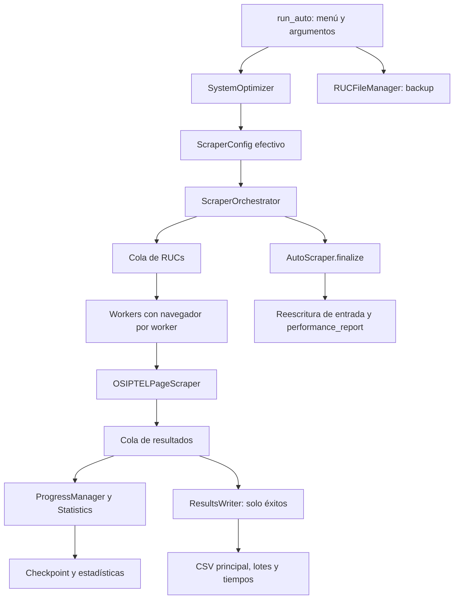

# OSIPTEL Scraper — manual completo y plan de mejora

> Publicación en GitHub: esta distribución conserva el código auditado, con usuario y contraseña vacíos en `config.py` y `ProxyConfig`. Las referencias a credenciales embebidas describen la copia local auditada; la externalización sigue pendiente. Se conserva el archivo MIT `LICENSE` ya existente en el repositorio de destino. No se publican CSV operativos, resultados, ZIP ni cachés.

Scraper local asíncrono para consultar líneas telefónicas por RUC en OSIPTEL mediante Python, Camoufox y proxy residencial. Esta copia de OneDrive es la base de desarrollo seleccionada. Su punto de entrada habitual es `run_auto.py`.

**Revisión documental: 16/11/2026.** Este README reúne el funcionamiento actual, instalación, configuración efectiva, entradas/salidas, recuperación, los **18 gaps identificados** y las mejoras propuestas con criterios de aceptación. Puede leerse completo sin abrir los documentos complementarios.

Las propuestas siguen pendientes: esta revisión cambia documentación, no implementa correcciones. Las etiquetas 1.0/3.0/6.0 de fuentes y respaldos no representan un versionado consistente ni acreditan preparación para producción.

## Autor y contacto

**Autor:** Harold Alejandro Villanueva Borda

**Contacto:** [harrylex8@gmail.com](mailto:harrylex8@gmail.com)

## Stack tecnológico

| Tecnología | Versión declarada / base | Uso en el proyecto |
|---|---|---|
| Python | 3.10+ | Lenguaje principal y ejecución de scripts |
| asyncio | Biblioteca estándar de Python | Tareas concurrentes, colas, sincronización y coordinación de workers |
| Camoufox | >=0.4.11,<1.0.0 | Automatización del navegador basado en Firefox mediante AsyncCamoufox |
| JavaScript / DOM | Ejecutado dentro del navegador | Interacción con formularios y extracción de filas de resultados |
| aiofiles | >=24.0.0,<25.0.0 | Lectura y escritura asíncrona de resultados, progreso y lotes |
| pandas | >=2.2.0,<3.0.0 | Lectura y transformación de archivos tabulares y limpieza de la entrada |
| openpyxl | >=3.1.0,<4.0.0 | Soporte de Excel .xlsx para el lector interno; el lanzador automático sigue limitado a CSV |
| aiohttp | >=3.10.0,<4.0.0 | Consultas HTTP auxiliares para la heurística inicial de red |
| psutil | >=6.0.0,<7.0.0 | Detección de CPU, memoria y utilidades de contadores de red |
| Proxy residencial SmartProxy | Configuración local del proveedor | Conexiones de los navegadores y sesiones de proxy |
| CSV y JSON | Archivos locales | Persistencia de resultados, progreso, estadísticas y reportes; sin base de datos |
| Windows / Batch / PowerShell | Entorno de operación e instalación | Instalador start.bat y comandos de preparación y ejecución |
| venv y pip | Herramientas de Python | Entorno virtual e instalación de dependencias |
| Git y GitHub | Control de versiones | Historial del código, documentación y publicación del repositorio |

Los rangos corresponden a [requirements.txt](requirements.txt); no son versiones exactas instaladas ni un lockfile. La aplicación utiliza automatización de navegador y scripts locales; no incorpora un framework web.

## Contenido

- [Autor y contacto](#autor-y-contacto)
- [Stack tecnológico](#stack-tecnológico)

1. [Objetivo y estado del proyecto](#1-objetivo-y-estado-del-proyecto)
2. [Estructura y responsabilidades](#2-estructura-y-responsabilidades)
3. [Instalación y primera ejecución](#3-instalación-y-primera-ejecución)
4. [Operación, archivos y recuperación](#4-operación-archivos-y-recuperación)
5. [Configuración efectiva y consumo](#5-configuración-efectiva-y-consumo)
6. [Arquitectura y funcionamiento interno](#6-arquitectura-y-funcionamiento-interno)
7. [Gaps, mejoras propuestas y aceptación](#7-gaps-mejoras-propuestas-y-aceptación)
8. [Plan de implementación por etapas](#8-plan-de-implementación-por-etapas)
9. [Capacidad, rendimiento y validación](#9-capacidad-rendimiento-y-validación)
10. [Documentación y mantenimiento](#10-documentación-y-mantenimiento)

## 1. Objetivo y estado del proyecto

El sistema recibe un archivo de RUC, consulta el sitio con varios navegadores en paralelo y exporta modalidad, número telefónico y operadora. Guarda progreso, fallidos, lotes y estadísticas para apoyar procesos locales de consulta masiva.

| Capacidad | Estado real |
|---|---|
| Ejecución paralela | Implementada con tareas asyncio y un navegador por worker |
| Sesiones de proxy | Se generan por navegador y se renuevan al reiniciar/reintentar |
| Reintentos | Tres intentos totales por RUC en run_auto; backoff y jitter |
| Configuración inicial de recursos | Detecta CPU/RAM y usa heurísticas basadas en latencia directa |
| Resultados incrementales | CSV principal y lotes de hasta 1000 éxitos |
| Checkpoints | Cada 25 resultados consumidos y al cierre normal |
| Reanudación | Implementada parcialmente; excluye fallidos y puede sobrescribir lotes |
| Extracción completa | No garantizada; falta paginación y exportación sin truncamiento |
| Control de consumo | Corte deshabilitado; --bandwidth es nominal |
| Integridad ante caída | Sin transacción entre resultado, progreso y archivo de entrada |
| Ejecución desatendida | No disponible por CLI: se solicita selección de workers |
| Suite de tests y CI | Ausentes en el repositorio |

**Prioridad actual: integridad y recuperación.** Un `success` puede representar una consulta vacía no validada; `completed` no garantiza que todos los resultados estén guardados. Los fallidos se incorporan al conjunto procesado y el flujo automático puede eliminarlos de la entrada. El capítulo 7 explica cómo corregir cada problema y cómo comprobarlo.

## 2. Estructura y responsabilidades

La carpeta proporcionada por el usuario contiene otra carpeta con el mismo nombre. La raíz real es:

```text
C:\Users\harry\OneDrive\Documentos\osiptel scraper v2\osiptel scraper v2
```

```text
osiptel scraper v2/
├── README.md
├── config.py                 # Parámetros locales y credenciales
├── run_auto.py               # Menú, preparación, ejecución y reporte
├── osiptel_main.py           # Orquestador, colas y cierre
├── osiptel_worker.py         # Proxy, navegador, extracción y reintentos
├── osiptel_core.py           # Modelos, progreso, estadísticas y CSV
├── system_optimizer.py      # Recursos, heurísticas, reportes y entrada
├── requirements.txt         # Seis dependencias con rangos
├── start.bat                # Instalador para Windows
├── download_geoip.py        # Auxiliar no requerido por el motor actual
├── remove_duplicates.py     # Utilidad ad hoc con rutas fijas
├── .gitignore
├── docs/                    # Referencias técnicas por tema
├── rucs/                    # Datos de entrada locales
└── osiptel_main.zip         # Respaldo histórico
```

`venv/` y `osiptel_output/` se crean al instalar/ejecutar, no son fuentes. El ZIP no participa en runtime; conserva datos y documentación histórica que no deben sustituir la guía actual. No están presentes `run_scraper.py`, `test_proxy.py`, `test_single_ruc.py` o `merge_results.py` de las otras copias.

No existen API HTTP, interfaz web, scheduler o servicio desplegado. Esas extensiones no son requisitos para corregir el motor local.

## 3. Instalación y primera ejecución

### 3.1 Preparar el entorno

Ejecute en PowerShell desde la raíz real:

```powershell
Set-Location -LiteralPath 'C:\Users\harry\OneDrive\Documentos\osiptel scraper v2\osiptel scraper v2'
python -m venv venv
.\venv\Scripts\python.exe -m pip install -r requirements.txt
.\venv\Scripts\python.exe -m camoufox fetch
```

La base declarada es Python 3.10+. No hay matriz que certifique todas las versiones. Invocar explícitamente el Python del venv evita depender de la activación de PowerShell. El instalador alternativo `start.bat` se detalla en el capítulo 4.

### 3.2 Revisar credenciales

El flujo run_auto lee de `config.py` los valores de proxy y bloqueo de imágenes. Configure sus valores locales; los siguientes son solo marcadores, no credenciales operativas:

```python
PROXY_USERNAME = "USUARIO_DEL_PROVEEDOR"
PROXY_PASSWORD = "CLAVE_DEL_PROVEEDOR"
PROXY_HOST = "HOST_DEL_PROVEEDOR"
PROXY_PORT = 3120  # Sustituir si su servicio utiliza otro puerto
BLOCK_IMAGES = True
```

`ProxyConfig` contiene además valores embebidos y versionados. Hoy no existe carga de .env o variables de entorno: externalizarlos es una mejora pendiente G08. El sufijo de sesión usado es `_session-<id>`; no se validó en red que el proveedor actual acepte la configuración.

### 3.3 Preparar una copia de trabajo y ejecutar

Use un CSV separado por comas, con cabecera `RUC`, once dígitos y esa columna en primer lugar. Conserve el original fuera de la corrida. Ejemplo de estructura:

```csv
RUC
20100047218
20100130204
```

Si ya tiene `rucs/entrada_original.csv`, puede preparar la copia y ejecutar:

```powershell
Copy-Item -LiteralPath 'rucs/entrada_original.csv' -Destination 'rucs/entrada_trabajo_001.csv'
.\venv\Scripts\python.exe run_auto.py 'rucs/entrada_trabajo_001.csv' --output 'osiptel_output/corrida_001'
```

El ejemplo presupone que el origen existe y que esos nombres de trabajo/salida no pertenecen a una corrida anterior. El programa solicita modo automático o manual. Al finalizar normalmente puede reescribir la copia retirando éxitos y fallidos. Un output nuevo separa el progreso, pero no impide cambiar la entrada. Para una reanudación, lea primero sus limitaciones en el capítulo 4.


## 4. Operación, archivos y recuperación

### Entorno e instalación

Trabaje desde la carpeta interior del repositorio. Las rutas de entrada, salida e instalador se resuelven respecto del directorio de trabajo. Dependencias declaradas: Camoufox, aiofiles, aiohttp, pandas, openpyxl y psutil; sus rangos están en [requirements.txt](requirements.txt). No hay lockfile ni garantía de reproducir exactamente un entorno anterior.

La instalación manual está en el README. Como alternativa, `start.bat` verifica Python y, si no lo encuentra, intenta descargar e instalar Python 3.12.10 para todos los usuarios, refrescar PATH, crear/activar venv, instalar dependencias, descargar Camoufox y crear rucs. Esa versión es la fijada en el script, no una afirmación sobre la versión más reciente de Python.

Ejecute el BAT desde su propia carpeta. No cambia de directorio por sí mismo. Puede requerir privilegios para instalar Python. Su refresco de PATH tiene problemas de expansión de variables en bloques y un fallo de descarga de Camoufox no impide que anuncie instalación completa. Verifique el resultado de cada etapa. No se ejecutó el instalador durante la revisión documental.

### Entrada admitida por el flujo habitual

Use CSV separado por comas, con cabecera y RUC en primera columna:

```csv
RUC
20100047218
20100130204
```

`AutoScraper.initialize` busca una columna cuyo nombre contenga ruc; el lector central toma siempre la primera; la limpieza usa otra heurística. Una única columna `RUC` evita esa discrepancia. Ambos lectores asumen cabecera: un archivo sin ella pierde la primera fila como dato. El lector central conserva caracteres numéricos y acepta longitud 11; no comprueba el dígito verificador ni deduplica. El preconteo automático exige once caracteres numéricos tras strip y puede diferir de la normalización posterior.

El lector central reconoce xlsx/xls, pero `run_auto.py` llama read_csv antes de alcanzarlo: no anuncie Excel como entrada funcional del lanzador. El motor de xls no está declarado en dependencias. `osiptel_main.py` puede ejecutarse directamente para su menú interno, pero usa otros defaults y no carga config.py; no es un reemplazo equivalente.

### Ejecución

Con la instalación lista, use una copia de trabajo del CSV y una carpeta nueva para una corrida nueva:

```powershell
.\venv\Scripts\python.exe run_auto.py 'rucs/mi_copia.csv' --output 'osiptel_output/corrida_001'
```

El menú aparece incluso antes de procesar argumentos como `--help`. Selección 1: detección inicial; selección 2: workers manuales de 1 a 50. Aun en modo manual se realiza la detección inicial de recursos/red. No existe --workers ni --no-cleanup ni --no-resume en la CLI.

| Argumento | Default | Efecto real |
|---|---|---|
| input_file | Obligatorio | Archivo comprobado mediante exists; lectura posterior CSV |
| --output / -o | osiptel_output | Directorio de resultados y progreso |
| --bandwidth / -b | 10000 | Valor nominal de presupuesto y reportes; **no corta tráfico** |

`AutoScraper` crea `<entrada>.backup` si no existe; no lo refresca en corridas posteriores. El backup está junto a la entrada, no en rucs/backups. No sustituye copias por corrida.

### Salidas y contratos

| Ruta relativa al output | Contenido / comportamiento |
|---|---|
| resultados.csv | Solo resultados SUCCESS, anexados; 301 columnas: RUC + 100 grupos Modalidad_i, Numero_Telefonico_i, Empresa_Operadora_i |
| progress.json | processed_rucs, failed_rucs, statistics y last_save; temporal .tmp seguido de os.replace |
| failed_rucs.csv | RUC, Error_Type, Error_Message, Attempts; generado al cierre si hay fallidos, con mensajes recortados |
| statistics.json | Resumen del orquestador al cierre |
| scraper.log | Log detallado anexado |
| save/<entrada>_1000_parteN.csv | Hasta 1000 resultados exitosos por lote; último lote puede ser menor; mismo esquema de 301 columnas |
| save/<entrada>_timing_report.json | summary y batches de los lotes del escritor actual |
| performance_report.json | timing, rucs, speed, bandwidth, workers, errors, retry_count, finish_reason del lanzador |

El 1000 cuenta resultados exitosos enviados al escritor, no todas las consultas. Un éxito sin líneas produce una fila con solo RUC. RUCResult.to_dict no serializa el detalle de PhoneLine: progress.json no permite reconstruir números perdidos. Las estadísticas pueden contar más de 100 líneas aunque la exportación descarte las adicionales. No hay archivo de errores actualizado por consulta.

### Reanudación e interrupciones

Reutilizar el mismo CSV de trabajo y el mismo --output carga progress.json y omite los RUC de processed_rucs, incluidos fallidos. Resultados CSV se anexan. Sin embargo, índices de lote y tiempos empiezan de cero: los parciales anteriores pueden sobrescribirse. Antes de reanudar, preserve una copia del output y del CSV; no trate los parciales como respaldo acumulativo fiable.

Ctrl+C activa la parada del orquestador, solicita detener workers, espera tres segundos y cancela los restantes. Después intenta drenar resultados durante diez segundos y guardar pendientes del escritor, progreso y reportes. No garantiza completar todas las consultas en curso ni vaciar la cola. El reporte automático puede seguir diciendo completed.

No edite progress.json para forzar reintentos sin reconciliar CSV y lotes: puede duplicar datos o perder trazabilidad. Para reintentar fallidos, prepare un CSV de trabajo a partir de failed_rucs.csv con RUC como primera columna y use otro output; esto no recupera los falsos éxitos vacíos, que requieren revisión separada. Una corrida nueva con nuevo output puede volver a consultar RUC ya existentes: no hay deduplicación global.

No ejecute dos procesos con la misma entrada/output: no hay bloqueo entre procesos y el .tmp de progreso tiene un nombre común. Como práctica operativa, deje cerrar el proceso y sincronizar OneDrive antes de copiar o comparar resultados.

### Diagnóstico

| Síntoma | Comprobación |
|---|---|
| Error de importación | Asegurar intérprete del venv y dependencias instaladas |
| No abre navegador | Revisar log y resultado de python -m camoufox fetch |
| Proxy falla | Revisar config.py y log; is_configured solo verifica valores no vacíos, no autentica |
| Muchos éxitos vacíos | Contrastar una muestra con consultas válidas; no asumir ausencia de líneas |
| Menos filas que consultas | Fallidos no entran al CSV principal; revisar consumidor y errores de escritura |
| Reporte negativo o ETA extraña | Estadísticas restauradas se mezclan con el tamaño actual de una entrada que se va reduciendo |
| Consumo mayor al presupuesto | Corte desactivado y consumo fijo estimado, no medido |
| Lotes desaparecidos | Reanudación reinició parteN; conservar snapshot antes de continuar |

`remove_duplicates.py` no es diagnóstico: ejecuta operaciones al importar, usa rutas fijas a resultados.csv y rucs/ruc_faltante_osiptel_parte1.csv y reescribe este último sin backup propio. No se integra al flujo habitual. `download_geoip.py` llama una API ausente en la clase instalada durante la revisión local; GeoIP está desactivado en el navegador principal. Ninguno es requisito de instalación.


## 5. Configuración efectiva y consumo

### Fuentes de configuración

`run_auto.py` importa credenciales, host/puerto y BLOCK_IMAGES de config.py. Aunque importa MAX_BANDWIDTH_MB y OUTPUT_DIRECTORY, usa defaults propios de argumentos/constructor. No importa MAX_WORKERS, MIN_DELAY, MAX_DELAY, MAX_RETRIES o USE_PERU_IPS. Crea ScraperConfig, lo modifica con recursos y argumentos, y fuerza tres intentos totales.

`osiptel_main.py` ejecutado directamente instancia ScraperConfig con defaults embebidos y no lee config.py. Su menú deja elegir entre 1 y 20 workers; los cambios de credenciales del menú son temporales y no se guardan al archivo. El menú se procesa una sola vez.

| Parámetro | config.py | Flujo run_auto.py |
|---|---|---|
| Credenciales / host / puerto | Valores locales; no se reproducen secretos | Se copian a ProxyConfig |
| USE_PERU_IPS | False | No se importa; el código usa el username tal como está y agrega _session-ID |
| MAX_WORKERS | 12 | Ignorado; detección o entrada manual 1–50 |
| MIN_DELAY / MAX_DELAY | 1 / 2 s | Ignorados; detección inicial |
| MAX_RETRIES | 2 | Ignorado; fuerza 3 intentos totales, aunque consola muestra 2 |
| MAX_BANDWIDTH_MB | 999999999 | Ignorado como default; CLI usa 10000; no hay corte |
| BLOCK_IMAGES | True | Usado; el ahorro porcentual de comentarios no está medido |
| OUTPUT_DIRECTORY | osiptel_output | Default CLI independiente del mismo nombre; --output lo cambia |

El sufijo de sesión se construye como `<username>_session-<id>`. No se comprobó autenticación, geolocalización ni compatibilidad actual con el proveedor. `use_peru_ips`, peru_port y get_effective_port no implementan una selección geográfica activa en este flujo.

### Heurísticas de recursos

SystemOptimizer toma núcleos físicos (fallback 4), hilos (fallback 8), CPU y RAM de psutil. Las consultas de red son directas a Google, Cloudflare e ipify, con timeout de cinco segundos por URL. Usa la menor latencia y supone 300 ms si no obtiene mediciones. No mide el proxy ni el caudal real: los Mbps son categorías inferidas.

Workers calculados: entero de min(núcleos × 2.5, RAM disponible MB / 350, factor red), acotado entre 4 y 24. Factores de red: 20 con latencia <100 ms, 16 con <200, 12 con <400 y 8 para el resto. El mínimo de cuatro puede exceder recursos en equipos limitados. El modo manual reemplaza solo el número de workers.

| Latencia usada | Delay mínimo–máximo entre RUCs |
|---|---|
| <100 ms | 0.5–1 s |
| <200 ms | 0.8–1.5 s |
| <400 ms | 1–2 s |
| Resto | 1.5–3 s |

El optimizador calcula 50/100/150/200 páginas por navegador según RAM, pero ese resultado no llega a BrowserManager: el límite efectivo es 150. No hay adaptación continua por carga, errores o rendimiento.

### Valores efectivos internos

| Área | Valor y consecuencia |
|---|---|
| Navegador | headless=True, humanize=True, block_images según config.py, geoip=False |
| Navegación | 120000 ms y networkidle fijados en worker; ignora page_timeout=45000 |
| Selector inicial | 30000 ms fijados; ignora selector_timeout=20000 |
| Búsqueda | Espera inicial 10000 ms; estabilidad hasta 30 controles cada 2000 ms y 3000 ms finales |
| Relecturas vacías | Hasta cuatro de 5000 ms si hay filas visibles; intento final de 8000 ms en condición sospechosa |
| Reintento de RUC | 3 intentos totales; base 5 s, multiplicador 2, límite nominal 30 s, después jitter de hasta 30%; rotación para reintentar |
| Checkpoint | Cada 25 resultados consumidos; guardado final adicional |
| Lote | 1000 éxitos; subcarpeta save; tamaño no expuesto por CLI |
| Exportación | 100 líneas por RUC, 301 columnas; trunca excedentes |
| Tráfico | 550 KB añadidos por resultado; no por intento; sin medición real ni corte |
| Consumidor | Espera resultados hasta 60 s con condición de salida defectuosa; cierre hasta 10 s |

En ScraperConfig siguen declarados navigation_timeout, delay_after_error, warn_bandwidth_percent, max_rucs_for_10gb y track_bandwidth sin un control efectivo equivalente en el flujo. calculate_max_rucs y validate_ruc_count calculan límites nominales; el último no se invoca en la ejecución normal. BandwidthMonitor y BandwidthTracker son auxiliares desconectados del scraping; conectarlos sin cambios mediría tráfico global del equipo, no solo del proxy.

### Secretos y cambios futuros

Existen credenciales embebidas tanto en config.py como en ProxyConfig y ambos están versionados. No hay soporte .env implementado. La mejora pendiente es una sola fuente validada al inicio, secretos externos y configuración efectiva registrada sin secretos. No copie credenciales a ejemplos, issues o logs. Si se compartieron fuentes o historial, la retirada de valores actuales por sí sola no retira los secretos históricos.


## 6. Arquitectura y funcionamiento interno

### Componentes y flujo



Los workers son tareas asyncio, no procesos. Cada worker administra una instancia de navegador; pandas, psutil y varias escrituras de cierre son síncronas dentro del proceso. Las colas no tienen tamaño máximo y se encolan todos los pendientes al iniciar: no hay backpressure explícito.

### Preparación y coordinación

AutoScraper.initialize detecta recursos/red, aplica workers manuales si los hay, crea backup, configura el motor y prelee el CSV para contar válidos. Esta inicialización ocurre antes del try/finally de run: sus errores no garantizan reporte final. Un archivo sin RUC válidos retorna antes de finalizar.

ScraperOrchestrator.run instala sus propios handlers de señales, valida que las credenciales no están vacías, lee entradas, carga progreso si resume=True y filtra pending contra processed_rucs. Si no hay pendientes retorna sin ejecutar todo el cierre normal. Restaura contadores acumulados, pero fija total_rucs al tamaño del archivo actual, que puede haberse reducido.

Inicializa escritor, colas y un sentinel None por worker. Inicia consumidor y workers escalonados: 0–3 esperan entre 0 y 2 s, 4–7 entre 2 y 5, el resto entre 4 y 8. No es un planificador de tasa global. Supervisa tareas cada segundo y reúne sus resultados con return_exceptions=True.

### Proxy, navegador y extracción

ProxyManager serializa generación de ids con asyncio.Lock; combina worker, contador, tiempo y aleatoriedad. BrowserManager crea AsyncCamoufox con la sesión y opciones de configuración. Reutiliza navegador hasta 150 páginas, lo reinicia al rotar IP y limpia el contexto al cerrar. Una página nueva por RUC/intento; no una sesión nueva garantizada por RUC. La recuperación ante crash depende también de rotate_ip; get_browser no verifica explícitamente una conexión viva antes de reutilizarla.

OSIPTELPageScraper navega a la URL del sitio, espera #IdTipoDoc, establece tipo 2 y #NumeroDocumento mediante JavaScript y dispara #btnBuscar. Intenta seleccionar 100 en GridConsulta_length y espera estabilidad de filas en #GridConsulta. La estabilidad exige cuatro comparaciones consecutivas iguales tras un primer conteo, admite conteo cero y no demuestra que la respuesta de negocio sea válida. Agotar controles no lanza un error específico de carga incompleta.

La extracción JavaScript omite primera fila, GridPager, ocultos mediante estilos inline, filas con menos de tres celdas y ciertos textos de carga/vacío. No usa visibilidad computada ni verifica formato de teléfono/operadora. Mapea las tres primeras celdas a PhoneLine. No recorre páginas posteriores. Si no aparece una excepción, devuelve SUCCESS incluso con lista vacía. Las relecturas en vacío se limitan a ciertas condiciones de tabla visible, por lo que no son garantía contra falsos negativos.

Worker intenta el RUC hasta max_retries veces en total, cierra página en finally y retorna inmediatamente ante SUCCESS, incluso sin líneas. Entre fallos aplica backoff y jitter y rota navegador/sesión. Las excepciones se clasifican principalmente por textos; no hay clasificación estructurada de respuestas del proveedor. Un error en rotación fuera del bloque principal de intento puede terminar el worker. Worker.run registra excepciones generales y sale sin asegurar un resultado para el RUC en curso.

### Modelos

| Tipo | Contrato |
|---|---|
| TaskStatus | pending, in_progress, success, failed, skipped; no hay máquina de estados persistida completa |
| ErrorType | timeout, proxy_error, page_load_error, selector_not_found, data_extraction_error, browser_crash, rate_limited, unknown |
| PhoneLine | modalidad, numero y operadora; to_dict devuelve esos campos |
| RUCResult | ruc, status, lines, error_type/message, attempts, timestamp y duración; success deriva de status y line_count de len(lines) |
| Statistics | Totales, éxitos, fallos, líneas, consumo estimado, tiempos, errores e intentos extra |
| SystemResources | Snapshot CPU/RAM/SO/Python, latencia, Mbps inferidos y configuración calculada |
| PerformanceReport | Resumen del lanzador; no recibe automáticamente todas las métricas de Statistics |

RUCResult.to_dict omite lines y conserva su conteo; no es una serialización recuperable del resultado completo. Statistics.rate_per_hour usa el tiempo desde start_time restaurado: incluye pausas entre ejecuciones. ETA puede resultar inconsistente cuando el total actual es menor que processed acumulado.

### Persistencia y concurrencia

El consumidor actualiza progreso en memoria antes de escribir el resultado exitoso. Cada 25 resultados guarda checkpoint. ProgressManager usa lock local y reemplazo de temporal para su JSON; esto no crea una transacción con CSV, lotes o entrada ni protege contra dos procesos. Tanto éxitos como fallidos entran a processed_rucs y los fallidos no se retiran automáticamente de failed_rucs si luego aparece un éxito por otra vía.

ResultsWriter protege escrituras dentro del proceso con lock. initialize inspecciona cabecera existente, no reconcilia filas con progreso ni migra esquemas antiguos. write_result anexa una fila de 301 columnas y acumula el objeto en memoria hasta el lote. _save_batch abre archivos con w, registra tiempos y reinicia buffer. El Índice y tiempos no se restauran; el reporte se reescribe. La primera duración de lote empieza en el constructor e incluye preparación. Los lotes reflejan orden de finalización de workers, no orden original.

El escape CSV es manual, duplica comillas y protege comas/saltos de línea; no implementa un serializador general ni trata explícitamente retorno de carro aislado. CSV principales y fallidos usan UTF-8 con BOM; la limpieza de entrada mediante pandas cambia su serialización a defaults de to_csv.

### Cierre

Al finalizar workers se encola None al consumidor. Se espera hasta diez segundos y se cancela en cualquier excepción sin propagar un diagnóstico completo. Después se finaliza escritor, guarda progreso y exporta fallidos/estadísticas. No hay validación de que cada entrada tenga un resultado durable.

El consumidor puede salir tras un timeout cuando un worker ya terminó aunque otros sigan activos: usa all(not done) en lugar de comprobar actividad pendiente suficiente. No se llama queue.join para garantizar drenado y el sentinel del consumidor no se marca task_done; introducir join exige corregir también ese contrato.

AutoScraper copia processed_rucs y algunos contadores si el orquestador retorna, establece completed y luego limpia el CSV y guarda reporte. Si el orquestador arroja una excepción antes de la copia, el lanzador puede perder esas métricas aunque exista progreso en disco. Su handler _interrupted es reemplazado por el del orquestador y no gobierna la parada. PerformanceReport recalcula remaining sin max(0), pudiendo deshacer la protección que hizo AutoScraper.

### Límites del sistema actual

No hay API, base transaccional, scheduler, almacenamiento remoto de aplicación, bloqueo entre procesos ni despliegue definido. OneDrive sincroniza archivos como parte del entorno del usuario, no como una capa de persistencia implementada por el scraper. El ZIP y cachés pyc no participan en el flujo fuente normal. Las propuestas de evolución están en [Gaps y mejoras](docs/GAPS_Y_MEJORAS.md).

## 7. Gaps, mejoras propuestas y aceptación

Los 18 gaps siguientes están **abiertos**. P0 corresponde a integridad y recuperación; P1 a controles y validación; P2 a mantenimiento y eficiencia. Las prioridades no son una promesa de fecha. Cada propuesta incluye el resultado verificable que permitiría cerrarla.

### G01 · P0 · Éxitos vacíos sin evidencia

Evidencia: [osiptel_worker.py:198](osiptel_worker.py#L198).

**Gap:** Puede persistir ausencia de datos como éxito y retirarla de pendientes.

**Mejora pendiente:** Distinguir consulta válida sin líneas, carga incompleta, bloqueo y error; exigir señal explícita del sitio.

**Aceptación:** Página sin tabla, carga tardía y bloqueo nunca terminan como éxito vacío; cero válido tiene evidencia verificable.

### G02 · P0 · Extracción y exportación incompletas

Evidencia: [osiptel_worker.py:393](osiptel_worker.py#L393).

**Gap:** Sin recorrido de paginación; escritor limita a cien líneas.

**Mejora pendiente:** Recorrer páginas hasta total y exportar sin pérdida, preferiblemente una fila por línea con identidad de consulta.

**Aceptación:** Casos 0, 1, 100 y más de 100 líneas concilian el total y todos los registros persisten.

### G03 · P0 · Sobrescritura al reanudar lotes

Evidencia: [osiptel_core.py:505](osiptel_core.py#L505).

**Gap:** Índice y tiempos reinician; modo w reemplaza parciales existentes.

**Mejora pendiente:** Recuperar manifiesto de lotes o usar nombres únicos por ejecución; escrituras atómicas.

**Aceptación:** Interrumpir/reanudar varias veces conserva hashes de lotes cerrados y un historial acumulativo coherente.

### G04 · P0 · Fallo y éxito comparten procesados

Evidencia: [osiptel_core.py:472](osiptel_core.py#L472).

**Gap:** Fallidos no vuelven a pendientes y run_auto los borra de entrada.

**Mejora pendiente:** Separar estados y hacer limpieza de entrada opcional, solo tras persistencia confirmada.

**Aceptación:** Fallo agotado sigue recuperable; entrada se conserva por defecto; ningún fallo se elimina como éxito.

### G05 · P0 · Consumidor y cierre incompletos

Evidencia: [osiptel_main.py:87](osiptel_main.py#L87).

**Gap:** Un worker terminado permite salida del consumidor tras timeout aunque queden activos; cierre cancela tras diez segundos.

**Mejora pendiente:** Protocolo de fin explícito, drenado y propagación de errores; supervisar productor/consumidor juntos.

**Aceptación:** Un worker lento junto a uno terminado no pierde resultados; backlog y fallo de disco no producen completed engañoso.

### G06 · P0 · Persistencia sin transacción ni idempotencia

Evidencia: [osiptel_main.py:110](osiptel_main.py#L110).

**Gap:** Marca procesado antes del CSV; caída entre archivos permite pérdida o duplicados.

**Mejora pendiente:** Resultado y estado durables por identidad, transacción o journal reconciliable y exportación derivada.

**Aceptación:** Inyectar caída en cada frontera de escritura y reanudar sin perder ni duplicar resultados.

### G07 · P1 · Presupuesto nominal sin corte

Evidencia: [osiptel_core.py:488](osiptel_core.py#L488).

**Gap:** --bandwidth no limita; monitor desconectado; 550 KB por resultado ignora tráfico real.

**Mejora pendiente:** Definir estimación frente a medición y modo ilimitado explícito; integrar corte configurable.

**Aceptación:** Con presupuesto pequeño se detienen nuevas consultas y se guardan pendientes; reporte distingue medido/estimado.

### G08 · P1 · Credenciales en código e historial

Evidencia: [config.py:18](config.py#L18).

**Gap:** Secretos también embebidos en ProxyConfig versionado.

**Mejora pendiente:** Externalizar credenciales y validar al inicio; revisar exposición histórica y rotar cuando corresponda.

**Aceptación:** Clonado sin secretos falla con mensaje claro; logs y documentación no revelan credenciales.

### G09 · P1 · Config dispersa y flags ausentes

Evidencia: [run_auto.py:54](run_auto.py#L54).

**Gap:** Constantes ignoradas, tres intentos efectivos y dos impresos; menú impide automatización.

**Mejora pendiente:** Fuente única y config efectiva; flags de workers, modo no interactivo, resume y limpieza.

**Aceptación:** Cada ajuste cambia conducta comprobable; --help no pide entrada ni hace red.

### G10 · P1 · Entradas y columnas inconsistentes

Evidencia: [run_auto.py:160](run_auto.py#L160).

**Gap:** Preconteo, lector y limpieza usan reglas diferentes; Excel falla en automático; duplicados se encolan.

**Mejora pendiente:** Lector común con esquema explícito, validación y deduplicación; soporte Excel declarado según motores.

**Aceptación:** Columnas reordenadas, repetidos, CSV sin cabecera y Excel producen resultado o error explícito coherente.

### G11 · P1 · Estado compartido sin identidad

Evidencia: [osiptel_main.py:179](osiptel_main.py#L179).

**Gap:** Output fijo mezcla trabajos; no hay bloqueo entre procesos; resume=False no borra CSV existente.

**Mejora pendiente:** Identidad de dataset/corrida, directorios propios, bloqueo y políticas explícitas de anexado.

**Aceptación:** Dos entradas y dos procesos no mezclan progreso ni corrompen temporales.

### G12 · P1 · Reportes y señales ambiguos

Evidencia: [run_auto.py:182](run_auto.py#L182).

**Gap:** completed tras interrupción; estadísticas restauradas frente a total reducido; errores/reintentos no copiados al reporte.

**Mejora pendiente:** Estado de salida común, métricas de sesión separadas de acumuladas y cierre ante fallo de inicialización.

**Aceptación:** Ctrl+C y errores reportan su causa real; remaining no es negativo y reportes concilian con registros persistidos.

### G13 · P2 · Optimizador heurístico desconectado en parte

Evidencia: [system_optimizer.py:265](system_optimizer.py#L265).

**Gap:** Mide endpoints directos; Mbps inferidos; páginas calculadas no se aplican; mínimo cuatro workers.

**Mejora pendiente:** Medir ruta relevante y memoria efectiva; aplicar parámetros y permitir uno o menos workers según recursos.

**Aceptación:** Telemetría identifica ruta medida, no llama latencia del proxy a conexión directa, y respeta memoria disponible.

### G14 · P2 · Esperas y clasificación frágiles

Evidencia: [osiptel_worker.py:209](osiptel_worker.py#L209).

**Gap:** Timeouts hardcodeados, estabilidad cero aceptada, silencios en selector de tamaño y clasificación por texto.

**Mejora pendiente:** Esperar estados observables con timeouts configurables y clasificar errores con contexto.

**Aceptación:** Configuración cambia tiempos; cargas incompletas y errores de selector generan diagnósticos y reintentos adecuados.

### G15 · P2 · Instalador y auxiliares sin contrato

Evidencia: [start.bat:24](start.bat#L24).

**Gap:** CWD relativo, refresco PATH defectuoso y éxito tras fetch fallido; GeoIP incompatible localmente y deduplicador destructivo ad hoc.

**Mejora pendiente:** Instalador reproducible con comprobaciones y auxiliares con argumentos, main guard, backup y dry-run.

**Aceptación:** Instalación desde otra carpeta y fallos de descarga producen estado correcto; importar auxiliar no modifica archivos.

### G16 · P2 · Higiene de mantenimiento

Evidencia: [osiptel_core.py:185](osiptel_core.py#L185).

**Gap:** Imports/campos sin uso, formatter muta LogRecord, handlers se limpian sin cierre explícito; excepciones amplias.

**Mejora pendiente:** Eliminar código muerto tras verificar referencias y centralizar logging/errores con recursos cerrados.

**Aceptación:** Reinicialización no fuga handlers; ambos destinos reciben nivel legible; fallos no quedan ocultos.

### G17 · P1 · Sin pruebas de recuperación ni entorno fijado

Evidencia: [requirements.txt:8](requirements.txt#L8).

**Gap:** Rangos no fijan entorno exacto; no hay tests/CI ni cobertura de corrupción y reinicio.

**Mejora pendiente:** Suite local con fixtures de DOM y fallos de I/O, lockfile y CI antes de depender de corridas grandes.

**Aceptación:** Pruebas de G01–G06 pasan sin red y una instalación limpia usa versiones reproducibles.

### G18 · P2 · Versionado, licencia y documentación

Evidencia: [README.md:1](README.md#L1).

**Gap:** Etiquetas de versión incompatibles y necesidad de unificar la referencia a LICENSE; README histórico del ZIP contradice código actual.

**Mejora pendiente:** Definir versión/release y confirmar licencia; mantener documentación ligada a cambios de comportamiento.

**Aceptación:** Release identificable, licencia confirmada y documentación validada contra código sin promesas de capacidad no medidas.


## 8. Plan de implementación por etapas

El orden busca resolver pérdidas de datos antes de aumentar velocidad o añadir interfaces. Ninguna etapa se implementó con esta actualización documental.

| Etapa | Trabajo propuesto | Entregable y condición para avanzar |
|---|---|---|
| 1. Reproducción y contratos | Convertir los casos G01–G06 en pruebas locales; definir éxito, vacío válido, fallo e interrupción | Fixtures y fallos inyectados que reproduzcan los errores actuales sin depender de la red |
| 2. Extracción completa | Validar finalización, recorrer paginación, exportar todas las líneas y respetar timeouts | Casos de 0/1/100/>100 líneas conciliados; ausencia de tabla nunca se acepta como cero válido |
| 3. Recuperación durable | Persistir resultado/estado de forma consistente, restaurar lotes y drenar colas | Repetir interrupciones en puntos de escritura sin pérdida, duplicados ni sobrescritura de lotes cerrados |
| 4. Control de trabajos | Separar fallidos y éxitos, identificar dataset/corrida y bloquear procesos incompatibles | Reintentos recuperables y entrada conservada por defecto; dos trabajos no mezclan estado |
| 5. Configuración y operación | Unificar opciones, externalizar secretos, restaurar presupuesto, CLI no interactiva y reportes fieles | Cada parámetro tiene efecto comprobable; interrupción y errores generan estados correctos |
| 6. Rendimiento y entrega | Medir recursos/proxy, fijar dependencias, corregir instalador, CI y releases | Entorno reproducible y benchmark con resultados verificados, sin usar el conteo de éxitos como única medida |

### Diseño propuesto para resultados y progreso

Evaluaría almacenamiento transaccional local, por ejemplo SQLite, para guardar consulta, estado, intentos y líneas relacionadas en una misma operación. Los CSV y lotes podrían generarse desde ese registro durable. Esto reduce el problema de coordinar CSV, JSON y entrada como fuentes independientes de verdad. **No es una dependencia ni arquitectura implementada actualmente.**

Para exportación, propongo una tabla de consultas y otra con una fila por línea telefónica, relacionadas por identidad de consulta y RUC. Un RUC con 150 líneas tendría 150 filas de detalle; una consulta válida sin líneas quedaría en la tabla de consultas con estado explícito. Si se necesita CSV ancho por compatibilidad, debería ser una exportación derivada que anuncie y controle su límite.

### Cómo aprovechar las otras copias

La versión “- no optimo” conserva un corte de consumo estimado y lotes de anchura variable sin el truncamiento fijo del escritor actual. D: conserva diagnósticos de proxy y RUC individual. Conviene recuperar esas ideas con pruebas, no copiar módulos enteros: las otras copias también comparten fallos de recuperación y falsos éxitos. Su código no se modificó ni incorporó en esta tarea.

### Funciones futuras opcionales

Una API, dashboard, scheduler, notificaciones o despliegue remoto pueden evaluarse cuando el motor cumpla los criterios anteriores y exista una necesidad concreta. Hoy no tienen contrato, implementación o fecha. La prioridad propuesta es poder confiar en los datos y retomar una corrida, no ampliar superficies de ejecución todavía.

## 9. Capacidad, rendimiento y validación

### Consumo: fórmula disponible y sus límites

El motor añade por defecto **550 KB estimados por resultado** y convierte con divisores 1024. No mide bytes reales, no contabiliza cada intento y no impone el presupuesto. El método calculate_max_rucs aplica:

```text
RUC nominales = floor(presupuesto_MB × 1024 / estimación_KB_por_RUC)
```

Por ejemplo, con 10000 unidades MB y 550 KB la fórmula devuelve 18618 RUC nominales. Es un cálculo del modelo interno, no una capacidad demostrada, límite de facturación o recomendación para una corrida. Tampoco asegura equivalencia con las unidades comerciales del proveedor. No se conservan tablas de planes o puertos que no se hayan contrastado con el servicio usado.

### Cómo obtener estimaciones útiles

Propongo medir una muestra controlada después de resolver la validación de resultados: tiempo total, éxitos verificados, fallos, reintentos, líneas obtenidas y tráfico atribuible al trabajo. Calcular RUC válidos por hora y coste por RUC incluyendo reintentos, y extrapolar con margen según variación observada. La latencia directa del optimizador actual no sustituye esa medición.

No hay benchmark que justifique prometer tiempos para 1000/10000 RUC, una cantidad fija de RAM por navegador o una tasa de bloqueo por número de workers. Subir concurrencia antes de arreglar las colas puede aumentar resultados pendientes de guardar. Las pausas internas también dominan la duración: reducir solo MIN_DELAY no implica una mejora equivalente del tiempo total.

### Validaciones disponibles

| Validación local durante la revisión | Resultado |
|---|---|
| Sintaxis de los ocho Python | AST válido; no demuestra funcionamiento integral |
| Escritura con 101 líneas simuladas | CSV de 301 columnas; línea adicional descartada |
| Segundo escritor en el mismo output temporal | Reemplaza parte1; no restaura índice/historial |
| Progreso con resultado FAILED | Queda fuera de pendientes al reanudar |
| Página simulada sin tabla | Devuelve success con cero líneas |
| Inspección de API GeoIP local | La clase instalada no tenía download_geoip |

Las pruebas anteriores se realizaron en la revisión local previa de esta conversación; no constituyen una suite guardada en el repositorio. No se ejecutó scraping real ni se autenticó contra el proxy. El instalador y el deduplicador no se ejecutaron. Los hallazgos de concurrencia/instalación derivan de lectura del código. Importar dependencias durante la revisión descargó definiciones auxiliares de fingerprints.

La primera suite propuesta debe cubrir DOM válido/vacío/bloqueado, paginación, reintentos, consumidores lentos, fallo de disco, caída entre escrituras, dos reanudaciones y aislamiento entre entradas. Los criterios de G01–G06 son las condiciones mínimas de recuperación, no comprobaciones satisfechas hoy.

## 10. Documentación y mantenimiento

Este README es el manual principal. Los documentos siguientes mantienen referencias por tema y el índice del código para trabajar sobre la implementación:

| Documento | Uso |
|---|---|
| [Operación](docs/OPERACION.md) | Procedimientos de instalación, archivos, diagnóstico y recuperación |
| [Configuración efectiva](docs/CONFIGURACION.md) | Parámetros usados e ignorados, defaults y heurísticas |
| [Arquitectura](docs/ARQUITECTURA.md) | Contratos internos, concurrencia y persistencia |
| [Gaps y mejoras](docs/GAPS_Y_MEJORAS.md) | Registro de los 18 gaps con evidencia y aceptación |
| [Revisión del código](docs/REVISION_CODIGO.md) | Inventario de clases/funciones, líneas, hashes y alcance |

Al cambiar comportamiento deben actualizarse el capítulo correspondiente de este README y su documento temático. Un gap se cierra con implementación y evidencia de aceptación, no por cambiar su redacción. Las líneas y hashes del índice son los de las fuentes revisadas y deben regenerarse si se modifica código.

Se retiraron de la documentación vigente afirmaciones de “Production Ready”, ahorro porcentual medido, ejecución totalmente automática, soporte Excel del lanzador y reanudación segura sin condiciones. Las cabeceras/comentarios de las fuentes y el README dentro del ZIP aún contienen etiquetas o afirmaciones antiguas; no se editaron como parte de la documentación activa.

Las cabeceras de código declaran MIT, y esta distribución incluye `LICENSE`. Se conserva la licencia MIT y titularidad que ya constan en el repositorio de destino. No hay política de releases definida, lockfile, suite automatizada o CI. Su incorporación está registrada en G17/G18.
