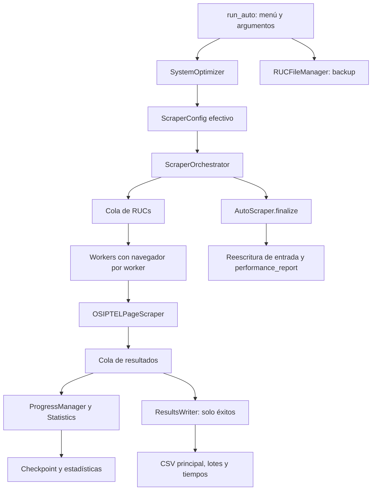

# Arquitectura y contratos internos

> Publicación en GitHub: esta distribución conserva el código auditado, con usuario y contraseña vacíos en `config.py` y `ProxyConfig`. Las referencias a credenciales embebidas describen la copia local auditada; la externalización sigue pendiente. Se conserva el archivo MIT `LICENSE` ya existente en el repositorio de destino. No se publican CSV operativos, resultados, ZIP ni cachés.

Revisado: 16/11/2026. [Índice](../README.md).

## Componentes y flujo

Los workers son tareas asyncio, no procesos. Cada worker administra una instancia de navegador; pandas, psutil y varias escrituras de cierre son síncronas dentro del proceso. Las colas no tienen tamaño máximo y se encolan todos los pendientes al iniciar: no hay backpressure explícito.

## Preparación y coordinación

AutoScraper.initialize detecta recursos/red, aplica workers manuales si los hay, crea backup, configura el motor y prelee el CSV para contar válidos. Esta inicialización ocurre antes del try/finally de run: sus errores no garantizan reporte final. Un archivo sin RUC válidos retorna antes de finalizar.

ScraperOrchestrator.run instala sus propios handlers de señales, valida que las credenciales no están vacías, lee entradas, carga progreso si resume=True y filtra pending contra processed_rucs. Si no hay pendientes retorna sin ejecutar todo el cierre normal. Restaura contadores acumulados, pero fija total_rucs al tamaño del archivo actual, que puede haberse reducido.

Inicializa escritor, colas y un sentinel None por worker. Inicia consumidor y workers escalonados: 0–3 esperan entre 0 y 2 s, 4–7 entre 2 y 5, el resto entre 4 y 8. No es un planificador de tasa global. Supervisa tareas cada segundo y reúne sus resultados con return_exceptions=True.

## Proxy, navegador y extracción

ProxyManager serializa generación de ids con asyncio.Lock; combina worker, contador, tiempo y aleatoriedad. BrowserManager crea AsyncCamoufox con la sesión y opciones de configuración. Reutiliza navegador hasta 150 páginas, lo reinicia al rotar IP y limpia el contexto al cerrar. Una página nueva por RUC/intento; no una sesión nueva garantizada por RUC. La recuperación ante crash depende también de rotate_ip; get_browser no verifica explícitamente una conexión viva antes de reutilizarla.

OSIPTELPageScraper navega a la URL del sitio, espera #IdTipoDoc, establece tipo 2 y #NumeroDocumento mediante JavaScript y dispara #btnBuscar. Intenta seleccionar 100 en GridConsulta_length y espera estabilidad de filas en #GridConsulta. La estabilidad exige cuatro comparaciones consecutivas iguales tras un primer conteo, admite conteo cero y no demuestra que la respuesta de negocio sea válida. Agotar controles no lanza un error específico de carga incompleta.

La extracción JavaScript omite primera fila, GridPager, ocultos mediante estilos inline, filas con menos de tres celdas y ciertos textos de carga/vacío. No usa visibilidad computada ni verifica formato de teléfono/operadora. Mapea las tres primeras celdas a PhoneLine. No recorre páginas posteriores. Si no aparece una excepción, devuelve SUCCESS incluso con lista vacía. Las relecturas en vacío se limitan a ciertas condiciones de tabla visible, por lo que no son garantía contra falsos negativos.

Worker intenta el RUC hasta max_retries veces en total, cierra página en finally y retorna inmediatamente ante SUCCESS, incluso sin líneas. Entre fallos aplica backoff y jitter y rota navegador/sesión. Las excepciones se clasifican principalmente por textos; no hay clasificación estructurada de respuestas del proveedor. Un error en rotación fuera del bloque principal de intento puede terminar el worker. Worker.run registra excepciones generales y sale sin asegurar un resultado para el RUC en curso.

## Modelos

| Tipo | Contrato |
|---|---|
| TaskStatus | pending, in_progress, success, failed, skipped; no hay máquina de estados persistida completa |
| ErrorType | timeout, proxy_error, page_load_error, selector_not_found, data_extraction_error, browser_crash, rate_limited, unknown |
| PhoneLine | modalidad, numero y operadora; to_dict devuelve esos campos |
| RUCResult | ruc, status, lines, error_type/message, attempts, timestamp y duración; success deriva de status y line_count de len(lines) |
| Statistics | Totales, éxitos, fallos, líneas, consumo estimado, tiempos, errores e intentos extra |
| SystemResources | Snapshot CPU/RAM/SO/Python, latencia, Mbps inferidos y configuración calculada |
| PerformanceReport | Resumen del lanzador; no recibe automáticamente todas las métricas de Statistics |

RUCResult.to_dict omite lines y conserva su conteo; no es una serialización recuperable del resultado completo. Statistics.rate_per_hour usa el tiempo desde start_time restaurado: incluye pausas entre ejecuciones. ETA puede resultar inconsistente cuando el total actual es menor que processed acumulado.

## Persistencia y concurrencia

El consumidor actualiza progreso en memoria antes de escribir el resultado exitoso. Cada 25 resultados guarda checkpoint. ProgressManager usa lock local y reemplazo de temporal para su JSON; esto no crea una transacción con CSV, lotes o entrada ni protege contra dos procesos. Tanto éxitos como fallidos entran a processed_rucs y los fallidos no se retiran automáticamente de failed_rucs si luego aparece un éxito por otra vía.

ResultsWriter protege escrituras dentro del proceso con lock. initialize inspecciona cabecera existente, no reconcilia filas con progreso ni migra esquemas antiguos. write_result anexa una fila de 301 columnas y acumula el objeto en memoria hasta el lote. _save_batch abre archivos con w, registra tiempos y reinicia buffer. El Índice y tiempos no se restauran; el reporte se reescribe. La primera duración de lote empieza en el constructor e incluye preparación. Los lotes reflejan orden de finalización de workers, no orden original.

El escape CSV es manual, duplica comillas y protege comas/saltos de línea; no implementa un serializador general ni trata explícitamente retorno de carro aislado. CSV principales y fallidos usan UTF-8 con BOM; la limpieza de entrada mediante pandas cambia su serialización a defaults de to_csv.

## Cierre

Al finalizar workers se encola None al consumidor. Se espera hasta diez segundos y se cancela en cualquier excepción sin propagar un diagnóstico completo. Después se finaliza escritor, guarda progreso y exporta fallidos/estadísticas. No hay validación de que cada entrada tenga un resultado durable.

El consumidor puede salir tras un timeout cuando un worker ya terminó aunque otros sigan activos: usa all(not done) en lugar de comprobar actividad pendiente suficiente. No se llama queue.join para garantizar drenado y el sentinel del consumidor no se marca task_done; introducir join exige corregir también ese contrato.

AutoScraper copia processed_rucs y algunos contadores si el orquestador retorna, establece completed y luego limpia el CSV y guarda reporte. Si el orquestador arroja una excepción antes de la copia, el lanzador puede perder esas métricas aunque exista progreso en disco. Su handler _interrupted es reemplazado por el del orquestador y no gobierna la parada. PerformanceReport recalcula remaining sin max(0), pudiendo deshacer la protección que hizo AutoScraper.

## Límites del sistema actual

No hay API, base transaccional, scheduler, almacenamiento remoto de aplicación, bloqueo entre procesos ni despliegue definido. OneDrive sincroniza archivos como parte del entorno del usuario, no como una capa de persistencia implementada por el scraper. El ZIP y cachés pyc no participan en el flujo fuente normal. Las propuestas de evolución están en [Gaps y mejoras](GAPS_Y_MEJORAS.md).
